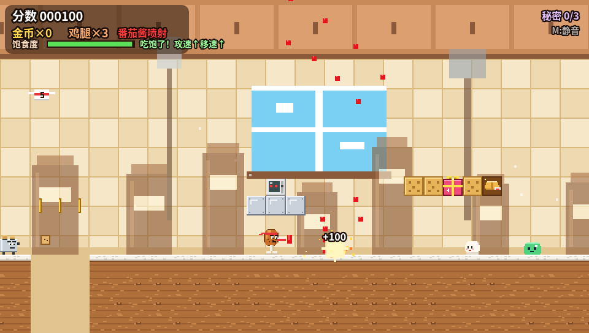

# 鸡腿侠大战厨房电器军团 🍗

一只愤怒的鸡腿，大战一整个想把它煮了的厨房。原创像素风横版「跑酷 + 射击 + 平台跳跃」网页小游戏，纯前端（HTML + JS + Canvas），所有像素美术与音效均由代码实时生成，无外部素材、无后端、无广告。

## 玩法
- **电脑**：←→ / A D 移动，↑↓ / W S 瞄准（8 方向，可空中斜射/向下射），空格 / K 跳，J / 鼠标左键 射击，P 暂停，M 静音
- **手机/平板**：左下摇杆移动 + 瞄准，右下「跳」「射」，「连发」自动开火（建议横屏）

## 特色
- 离谱武器：番茄酱喷射（散弹）、辣椒激光（穿透）、爆米花机枪（速射）、法棍火箭（爆炸，可炸饼干砖）——死亡会掉落
- 敌人：会吐吐司的烤面包机、飞行打蛋器、微波炉炮台、可踩的果冻（踩了弹更高）、刺栗子、跳跳汤圆、外卖飞盒（打下掉武器）
- 礼物盒 / 幸运饼干：随机效果——巨大化、缩小、重力反转 10 秒、黄油地板、天降外卖、金币雨
- 饱食度：吃敌人掉落的食物保持饱腹（攻速/移速提升），饿晕了会变慢
- 重力反转区：倒着在天花板上跑过深坑
- 隐藏房间、云端秘道、隐藏砖、连击倍率计分、检查点自动存档
- 3 关 + 3 个首领：电饭煲大魔王、附魔榨汁机、冰箱之王；进度保存在浏览器 localStorage

## 本地运行
任意静态服务器即可，例如：`python3 -m http.server`，然后打开 http://localhost:8000
